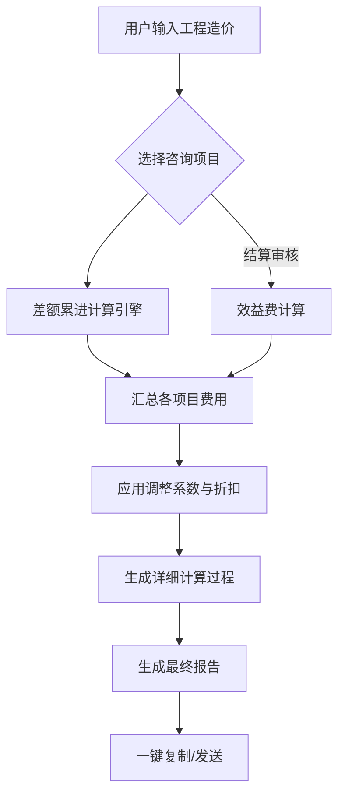

# 北京市建设工程造价咨询收费计算器需求文档

## 1. 产品定义
本产品是一款基于《北京市建设工程造价行业咨询服务费用计价参考》(京标价协(2022) 71号)及其最新补充标准的在线计算工具。旨在为造价咨询从业人员提供快速、准确、合规的费用计算服务。

## 2. 核心功能
### 2.1 差额定率累进计算 (MVP)
- **输入**: 工程造价 (万元)
- **选择**: 咨询服务项目 (支持多选)
- **逻辑**: 根据分档区间，自动进行累进计算。
- **分档区间 (X为计费基数，单位：万元)**:
  1. X ≤ 200
  2. 200 < X ≤ 500
  3. 500 < X ≤ 2000
  4. 2000 < X ≤ 10000 (1亿)
  5. 10000 < X ≤ 50000 (5亿)
  6. X > 50000

### 2.2 附加计算逻辑
- **效益费**: 结算审核等项目，费用 = 基本费 + (审减额 + 审增额) × 5%~10%。
- **审核类系数**: 投资估算、概算、清单、限价等审核类业务，按相应编制费用的 **0.9** 倍计算。
- **专项系数**: 单独委托的装饰、安装、修缮工程，费用乘以 **1.2**。
- **保底限额**: 
  - 单项咨询费最低 **3000元** (0.3万元)。
  - 纠纷鉴证最低 **20000元** (2万元)。

## 3. 数据契约 (费率表 - ‰)
| 序号 | 咨询项目名称 | X≤200 | 200-500 | 500-2000 | 2000-1亿 | 1亿-5亿 | 5亿以上 |
| :--- | :--- | :---: | :---: | :---: | :---: | :---: | :---: |
| 1 | 投资预算评审 | 3.5 | 3.0 | 2.5 | 2.2 | 2.0 | 1.6 |
| 2 | 投资估算编制 | 2.5 | 1.5 | 1.0 | 0.8 | 0.7 | 0.6 |
| 3 | 工程概算编制 | 2.8 | 2.5 | 2.0 | 1.8 | 1.5 | 1.3 |
| 4 | 设计经济分析 | 1.8 | 1.5 | 1.4 | 1.2 | 1.0 | 0.8 |
| 5 | 目标成本编制 | 2.5 | 2.0 | 1.8 | 1.5 | 1.3 | 1.2 |
| 6 | 工程量清单编制 | 3.3 | 2.8 | 2.5 | 2.3 | 2.0 | 1.8 |
| 7 | 最高投标限价编制 | 3.0 | 2.5 | 2.2 | 2.0 | 1.7 | 1.5 |
| 8 | 工程清标 | 2.0 | 1.8 | 1.5 | 1.0 | 0.8 | 0.6 |
| 9 | 重计量基本费用 | 4.5 | 4.0 | 3.5 | 3.0 | 2.5 | 2.0 |
| 11 | 施工过程造价管理 | 9.5 | 8.5 | 8.0 | 7.5 | 6.0 | 5.0 |
| 13 | 工程结算审核(一) | 5.0 | 4.5 | 4.0 | 3.5 | 3.0 | 2.5 |
| 14 | 工程结算审核(二) | 8.0 | 7.0 | 6.0 | 5.0 | 4.0 | 3.0 |
| 15 | 过程管理审计 | 6.3 | 5.6 | 4.5 | 3.8 | 3.5 | 2.8 |
| 16 | 竣工决算编制 | 2.0 | 1.8 | 1.5 | 1.3 | 1.2 | 1.0 |
| 17 | 建设项目后评价 | 1.8 | 1.5 | 1.2 | 1.0 | 0.8 | 0.6 |
| 18 | 工程造价纠纷鉴证 | 13% | 11% | 9% | 6.5% | 5.5% | 4.5% |

> 注：纠纷鉴证费率为百分比(%)，其余均为千分比(‰)。

## 4. 待办功能 (V2)
- 增加驻场人员费用计算模块。
- 增加钢筋单独计算模块 (按吨计费)。
- 支持导出 Word/PDF 格式的收费建议书。
- 增加计算历史记录。

---

## 架构设计蓝图

### 核心流程图 (Mermaid)

### 组件交互说明
- **InputPanel**: 负责收集造价、项目勾选、系数和折扣。
  - 当勾选“结算审核”时，自动展开“核减额”和“效益费率”输入框。
- **CalculatorEngine**: 纯JS逻辑，负责处理费率表匹配、累进计算及效益费叠加。
- **OutputPanel**: 负责渲染计算步骤和最终文本报告。

### 技术选型
- **Frontend**: HTML5, Tailwind CSS (UI), Vue.js (Reactivity).
- **Icons**: FontAwesome (CDN).
- **Deployment**: Single HTML file for portability.
